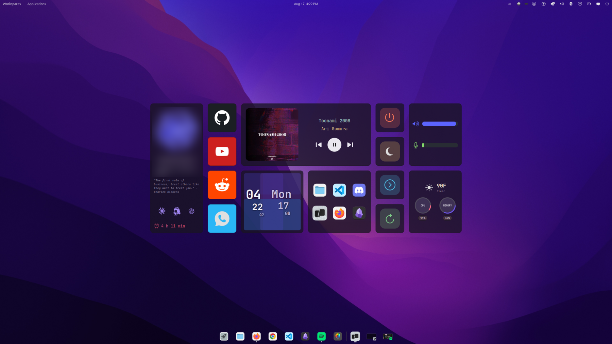
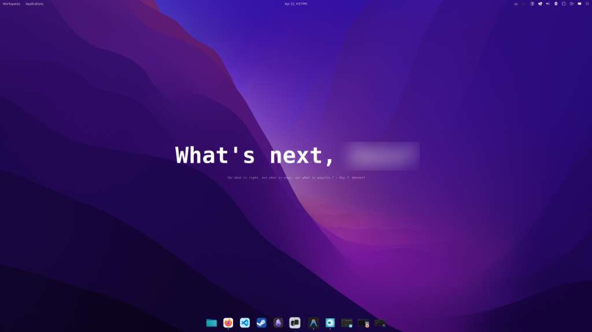

# eww-widgets

A collection of modular [Eww](https://github.com/elkowar/eww) widgets for Linux desktops.

Each module is self-contained - run it independently with its own `eww -c` config.





---

## Modules

### [center-cluster](./center-cluster)
A COSMIC/Wayland port of the central dashboard from
[husseinhareb/hyprland-eww](https://github.com/husseinhareb/hyprland-eww): profile
card, site tiles, MPRIS media, block clock, app launchers, power tiles with a
two-step confirm, audio sliders, and weather plus CPU/memory rings. Runs one
window per visible panel, so clicks in the gaps between panels reach the
application underneath. See its [README](./center-cluster) for the window and
input model, the wallpaper-driven theming, and the icon-theme sync.

### [clock-module](./clock-module)
A Rainmeter BC-lock inspired block clock. Five overlapping semi-transparent progress bars represent hours, minutes, seconds, month, and day - each sweeping in from a different direction. Fully themeable via SCSS variables.

### [stats-module](./stats-module)
System stats widget displaying CPU, RAM, GPU usage, CPU temperature, and local weather as vertical circular indicators.

### [greeting-module](./greeting-module)
A centered greeting widget with time-aware phrases (80+ across 5 time buckets) and a daily quote filtered to science, philosophy, politics, history, and technology topics.

---

## Personal settings

Your name and location stay out of the repo, in `~/.config/eww-widgets/local.env`:

```sh
EWW_NAME="Alex"          # greeting name, default "friend"
WEATHER_LAT="39.7392"    # weather location, default Denver
WEATHER_LON="-104.9903"
```

---

## Requirements
- [Eww](https://github.com/elkowar/eww) (ElKowar's Wacky Widgets)
- `bash`, `date` (standard on all Linux systems)
- `curl` (for greeting-module quote fetching)
- `Roboto Mono` font (optional but recommended)

---

## Usage

Each module runs independently:

```bash
# Center cluster (starts the daemon and opens every panel)
~/Desktop/eww-widgets/center-cluster/cluster.sh start

# Block clock
eww -c ~/Desktop/eww-widgets/clock-module open-many time-hour time-min time-sec date-month date-day

# Stats
eww -c ~/Desktop/eww-widgets/stats-module open stats-widget

# Greeting
eww -c ~/Desktop/eww-widgets/greeting-module open greeting
```

---

## Credits

The [center-cluster](./center-cluster) module is a port of the central dashboard
from [husseinhareb/hyprland-eww](https://github.com/husseinhareb/hyprland-eww) by
**Hussein Hareb**, used under the MIT licence. The layout, proportions and colour
palette are that project's design, and the three site tiles use its artwork. The
upstream licence text ships alongside the port in
[center-cluster/LICENSE.upstream](./center-cluster/LICENSE.upstream).

---

## License
MIT. The upstream licence covering the center-cluster design is kept in
[center-cluster/LICENSE.upstream](./center-cluster/LICENSE.upstream).
