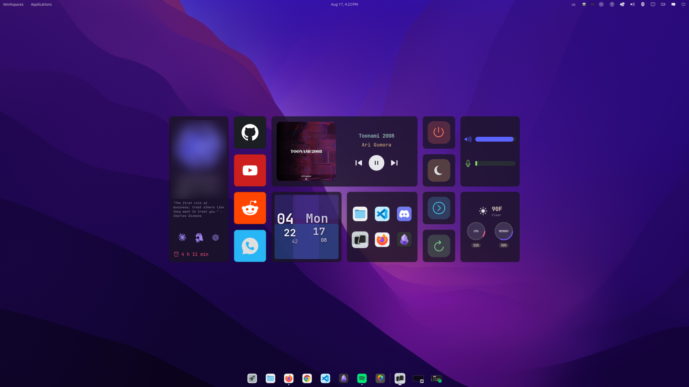
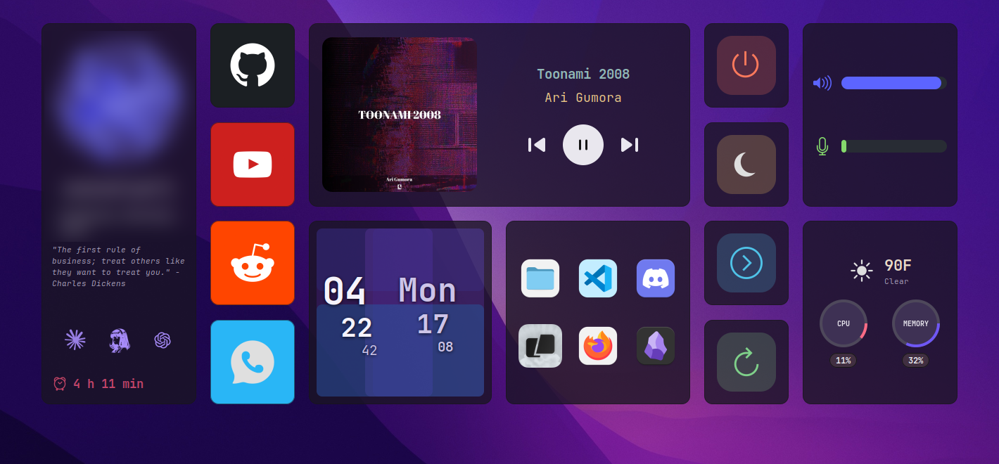
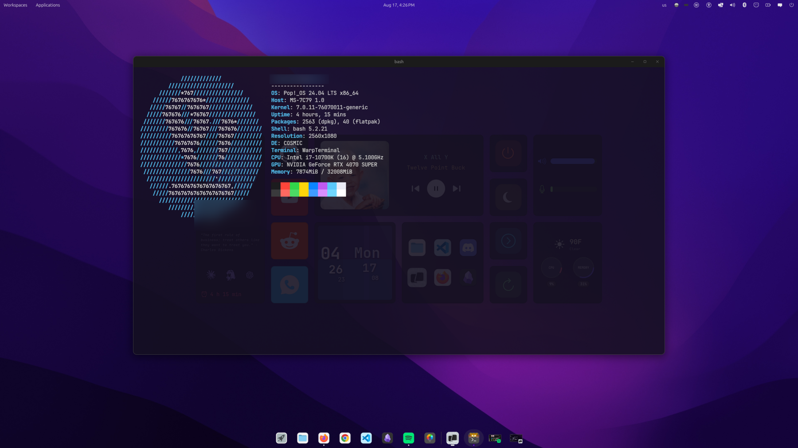

# Center cluster

A COSMIC/Wayland port of the middle dashboard from
[husseinhareb/hyprland-eww](https://github.com/husseinhareb/hyprland-eww).
Only the central cluster is reproduced. There is no top bar and no side panels.







```
             /////////////
         /////////////////////
      ///////*767////////////////
    //////7676767676*//////////////        user@pop-os
   /////76767//7676767//////////////       -----------------
  /////767676///*76767///////////////      OS: Pop!_OS 24.04 LTS x86_64
 ///////767676///76767.///7676*///////     Host: MS-7C79 1.0
/////////767676//76767///767676////////    Kernel: 7.0.11-76070011-generic
//////////76767676767////76767/////////    Uptime: 3 hours, 32 mins
///////////76767676//////7676//////////    Packages: 2563 (dpkg), 40 (flatpak)
////////////,7676,///////767///////////    Shell: bash 5.2.21
/////////////*7676///////76////////////    Resolution: 2560x1080
///////////////7676////////////////////    DE: COSMIC
 ///////////////7676///767////////////     CPU: Intel i7-10700K (16) @ 5.100GHz
  //////////////////////'////////////      GPU: NVIDIA GeForce RTX 4070 SUPER
   //////.7676767676767676767,//////       Memory: 6204MiB / 32008MiB
    /////767676767676767676767/////
      ///////////////////////////
         /////////////////////
             /////////////
```

Tested on Pop!_OS 24.04, COSMIC (cosmic-comp), Wayland, eww 0.6.0, HDMI-A-1 at
2560x1440.

## Run it

```sh
./cluster.sh start      # start the daemon and open all 15 windows
./cluster.sh reload     # re-read eww.yuck / eww.scss and reopen
./cluster.sh restart    # full teardown, then start
./cluster.sh stop       # close windows and kill the daemon
./cluster.sh status     # list open windows
```

`~/.config/systemd/user/eww-widgets.service` owns the daemon: it runs
`eww daemon --no-daemonize` at login, then `./cluster.sh open` to open the
windows. `start`, `stop` and `restart` delegate to that unit when it exists and
kill any hand-started daemon first, so a second set of windows cannot appear.

## Window and input model

This is the part that is easy to get wrong, so it was measured rather than
assumed.

* An eww window's surface is `max(:geometry, content natural size)`, and the
  **whole surface takes pointer input, transparent pixels included**. A window
  larger than the panel it draws becomes an invisible click-blocker.
* Therefore every window is sized to exactly one visible panel, and each panel
  paints edge to edge. The gaps between panels belong to no window, so clicks
  there reach whatever is underneath.
* The rule to preserve: the `.wid_get` root of a panel must stay align-free and
  `:hexpand true :vexpand true`. Putting `:valign "center"` on the root shrinks
  the paint to its natural size and leaves a transparent, click-swallowing
  margin inside the window. Centre content on an inner box instead.
* `:stacking "bottom"` puts the cluster above the wallpaper and below ordinary
  windows, so opening an app covers it.
  **Do not use `"bg"`.** Measured on cosmic-comp: `"fg"`, `"bottom"` and
  `"overlay"` receive pointer events, `"bg"` does not - a `"bg"` cluster renders
  normally and silently ignores every click.
* `:focusable false` everywhere. On layer-shell, `true` takes a keyboard grab
  and typing stops reaching the focused app. Pointer input works regardless.
* COSMIC's top panel reserves 32px, and layer-shell margins are measured from
  below it. The usable area on this monitor is 2560x1408. Window `y` values in
  `eww.yuck` are relative to that.

Verify geometry after layout changes by outlining the panels and measuring:

```sh
printf '\n.wid_get { border: 2px solid rgb(0,255,0); }\n' >> eww.scss
./cluster.sh restart     # screenshot, check each outline matches its :geometry
git checkout eww.scss    # or remove the rule
```

## Layout grid

Cluster is 1302x542, centred at x 629 / y 433 (relative to the usable area).

```
 629 profile | 869 links | 1009 media / clock+date+apps | 1571 power | 1711 system
 433 top row                                            | 714 bottom row
```

## Theming

`eww.scss` has two parts:

1. **Hand knobs** - `$panel-alpha` (transparency), `$panel-radius`,
   `$panel-border*`, `$font`, fixed accents, brand colours. Never touched by a
   script.
2. **AUTO-PALETTE block** - hue-derived colours, rewritten by
   `scripts/theme-from-wallpaper.sh`. Everything outside the two markers is
   left alone, so hand edits survive.

```sh
./scripts/theme-from-wallpaper.sh                    # retint from the COSMIC wallpaper
./scripts/theme-from-wallpaper.sh path/to/image.jpg  # from a specific image
HUE=280 ./scripts/theme-from-wallpaper.sh            # force a hue
THEME_MODE=light ./scripts/theme-from-wallpaper.sh   # light panels (reference look)
```

It reads the active wallpaper from the COSMIC background config, finds its
dominant hue, and rotates the reference palette to that hue. Saturation and
lightness stay pinned to values sampled from the reference screenshot, so the
cluster picks up the wallpaper's colour family without drifting off the
reference look. At `HUE=262` it reproduces the reference palette.

`THEME_MODE` (default `dark`) flips panels and text between a dark tint and the
reference's light one. Run `scripts/sync-icons.sh` with the same `THEME_MODE`
afterwards so the transport glyphs are tinted for the right background.

## Icons

`scripts/sync-icons.sh` regenerates every icon from the icon theme that is
currently applied, resolving each app the way the dock does: read `Icon=` from
the app's desktop entry, look that name up in the theme, honour the theme's
inheritance. Rasterised through librsvg/gdk-pixbuf, the renderer GTK itself
uses, so vector icons stay crisp.

```sh
./scripts/sync-icons.sh                    # theme from gsettings (currently Colloid)
ICON_THEME=Papirus ./scripts/sync-icons.sh
```

Anything Colloid does not ship falls back through Papirus, Adwaita, hicolor.
Warp is the only app icon without a Colloid version; it uses the app's own.

## Panels

| Panel | Contents |
| --- | --- |
| profile | artwork tile (launches Warp), user, greeting + quote, AI launchers, uptime |
| links | GitHub, YouTube, Planner (planner.zains.cc), WhatsApp - open in Firefox |
| media | MPRIS art / title / artist / transport, any player |
| blockclock | BC-Lock bars with the time and date staircases over them |
| apps | Files, VS Code, Discord, Warp, Firefox, Obsidian |
| power | shutdown, suspend, logout, reboot - two-step confirm |
| system | volume and mic sliders |
| resources | weather + temperature, CPU and memory rings |

Power tiles arm on the first click and run on the second; moving the pointer off
the tile disarms it, so a stray click cannot shut the machine down.

There is no brightness row: this desktop has no backlight (`/sys/class/backlight`
is empty), so the reference's brightness slider is dropped and the two remaining
rows are spread to keep the panel balanced.

## AI launchers

Two marks on the profile card, above the uptime line:

| Mark | Action |
| --- | --- |
| Duck | open the `aisp` session picker (Claude Code, Codex, Hermes) |
| ChatGPT | open ChatGPT in Firefox |

`scripts/ai.sh` drives them. The picker is its own project at
`~/Desktop/ai-session-picker` (GitHub `Vizim/ai-session-picker`), installed with
`pipx install -e ~/Desktop/ai-session-picker`; the cluster only launches it.
Its cache lives in `~/.cache/agent-picker/`. See that repo for how it works.

**Terminal.** The picker needs a terminal that can run a command, and Warp cannot:
its CLI exposes only cloud/agent subcommands with no exec flag, and its `warp://`
scheme has no run-command action - both checked against the installed build. So
the picker opens in `$AI_TERMINAL` (default `kitty`), while everything that only
needs "a terminal" (the profile tile) still uses Warp. Point `AI_TERMINAL` at any
terminal whose `-e` runs a command.

## Artwork and assets

Generated and third-party icons are gitignored (see the repo `.gitignore`).
Rebuild them after a clone:

```sh
./scripts/sync-icons.sh       # app, system, media and weather icons, from the icon theme
./scripts/sync-ai-icons.sh    # ChatGPT mark, tinted purple (the duck is tracked)
```

`sync-ai-icons.sh` reduces each source to its glyph alone, dropping the app-icon
plate behind it. The three sources need three different separations, which is why
the script has explicit modes: Claude's sunburst is darker than its cream plate,
the Hermes drawing is dark ink on white, and OpenAI's knot is white on a saturated
green plate - that last one defeats a luminance test, since a bright plate can
match white, so it keys on the minimum channel instead.

The profile disc art is not regenerable by script: it is Nous Research's Hermes
hero artwork, used locally and deliberately not redistributed. Drop any square
image at `images/icons/ui/profile.png` to replace it; `$tile-face` in `eww.scss`
sets the disc colour behind it.


## Block clock

`../clock-module` (BC-Lock) is merged into the `blockclock` tile: five
translucent progress bars, each filling in its own direction, with the time and
date staircases laid over them.

All five bars live in **one** `overlay` inside **one** window. The standalone
clock-module runs them as five stacked windows, which cannot work here - five
overlapping input regions would mean the topmost surface swallows every click
over that square.

Knobs are in `eww.scss` under "BC-Lock block clock": per-bar colour and opacity,
plus `$bc-scale` as a global multiplier (`0.0` hides the bars and leaves a plain
clock panel). `$bc-w` / `$bc-h` next to the bar rules are the tile's
`:geometry` minus its 1px border - a GTK progress bar has a thin natural size,
so without explicit sizes the bars render as edge strips instead of filling the
square. Keep those two in step with the window geometry.

## Credits and licence

The design is a port of the central dashboard from
**[husseinhareb/hyprland-eww](https://github.com/husseinhareb/hyprland-eww)** by
**Hussein Hareb**, which is MIT licensed. Full credit for the original layout and
look goes there.

What is carried over from upstream:

* the panel composition, proportions and grid
* the colour palette, sampled from the project's screenshot
  (panel `#9484ac`, the clock/date accents, the ring and pill treatments)
* the `github` / `youtube` tile artwork in `images/icons/websites/` (`planner` is the portfolio lambda mark)

Upstream's MIT licence text is kept alongside this port in
[`LICENSE.upstream`](LICENSE.upstream), as the licence requires.

What is new here: the COSMIC/Wayland window and input model, the single-window
block-clock port, the wallpaper-driven theming, the icon-theme sync, the weather
and media scripts, and the launcher/power handling.

The BC-Lock block clock is ported from `../clock-module` in this repo.


## Weather

`scripts/weather.sh` uses open-meteo, no API key, one cached request shared by
all three polls. Location and units come from `~/.config/eww-widgets/local.env`
(see the repo README) or the environment:

```sh
WEATHER_LAT, WEATHER_LON, WEATHER_UNIT (fahrenheit|celsius), WEATHER_TTL
```

Without them it falls back to Denver.

## Text and ASCII

Sources are ASCII-only (`.yuck`, `.scss`, shell). Icons are real image assets,
never Unicode glyph substitutes, so no icon font is required.

`scripts/greeting.sh` wraps the greeting-module output and normalises em dashes
and curly quotes from the quote API to ASCII. It also folds the text to a fixed
line count, because eww's `:limit-width` truncates with an ellipsis rather than
setting a wrap width - the line breaks have to come from the text itself.

## Keyboard

The cluster windows are unfocusable by design, so keyboard access goes through
COSMIC shortcuts that call the same scripts as the tiles. They live in
`~/.config/cosmic/com.system76.CosmicSettings.Shortcuts/v1/custom`.

| Tile            | Keys                | Runs                          |
|-----------------|---------------------|-------------------------------|
| Files           | Super+Shift+F       | `scripts/apps.sh --files`     |
| VS Code         | Super+Shift+V       | `scripts/apps.sh --vscode`    |
| Discord         | Super+Shift+D       | `scripts/apps.sh --discord`   |
| Warp            | Super+Shift+W       | `scripts/apps.sh --warp`      |
| Firefox         | Super+Shift+B       | `scripts/apps.sh --firefox`   |
| Obsidian        | Super+Shift+O       | `scripts/apps.sh --obsidian`  |
| Session picker  | Super+Shift+C / E   | `scripts/ai.sh claude` / `hermes` |
| ChatGPT         | Super+Shift+G       | `scripts/ai.sh chatgpt`       |
| GitHub          | Super+Ctrl+G        | `scripts/apps.sh --url ...`   |
| YouTube         | Super+Ctrl+Y        | `scripts/apps.sh --url ...`   |
| Planner         | Super+Ctrl+P        | `scripts/apps.sh --url ...`   |
| WhatsApp        | Super+Ctrl+W        | `scripts/apps.sh --url ...`   |

Media transport and the volume/mic sliders are not bound here: COSMIC already
maps the keyboard's media, volume, and mic-mute keys to those actions.
Power tiles are deliberately unbound. Use Super+Escape (lock) and
Super+Shift+Escape (log out) from COSMIC's defaults.
